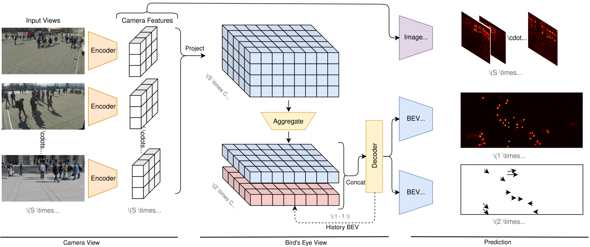

# TrackTacular :octopus:

**Lifting Multi-View Detection and Tracking to the Bird’s Eye View**

[Torben Teepe](https://github.com/tteepe),
[Philipp Wolters](https://github.com/phi-wol),
[Johannes Gilg](https://github.com/Blueblue4),
[Fabian Herzog](https://github.com/fubel),
Gerhard Rigoll

[](https://arxiv.org/abs/2403.12573)

[](https://paperswithcode.com/sota/multi-object-tracking-on-wildtrack?p=lifting-multi-view-detection-and-tracking-to)
[](https://paperswithcode.com/sota/multi-object-tracking-on-multiviewx?p=lifting-multi-view-detection-and-tracking-to)
[](https://paperswithcode.com/sota/multiview-detection-on-multiviewx?p=lifting-multi-view-detection-and-tracking-to)

> [!TIP]
> This work is an extension of your previous work [EarlyBird  🦅](https://github.com/tteepe/EarlyBird).
> Feel free to check it out and extend our multi-view object detection and tracking pipeline on other datasets!



## Usage

### Getting Started
1. Install [PyTorch](https://pytorch.org/get-started/locally/) with CUDA support
    ```shell
   pip3 install torch torchvision --index-url https://download.pytorch.org/whl/cu118
   ```
2. Install [mmcv](https://mmcv.readthedocs.io/en/latest/get_started/installation.html#install-with-pip) with CUDA support
   ```shell
   pip install mmcv==2.0.0 -f https://download.openmmlab.com/mmcv/dist/cu118/torch2.1/index.html
   ```
3. Install remaining dependencies
   ```shell
   pip install -r requirements.txt
   ```

### Training
```shell
python world_track.py fit -c configs/t_fit.yml \
    -c configs/d_{multiviewx,wildtrack,synthehicle}.yml \
    -c configs/m_{mvdet,segnet,liftnet,bevformer}.yml
```
### Testing
```shell
python world_track.py test -c model_weights/config.yaml \
    --ckpt model_weights/model-epoch=35-val_loss=6.50.ckpt
```

## BRL (this fork)
Training with missing annotations. With `--data.init_args.drop_ratio 20/45/60` the train split reads
`<data_dir>/drop_annotations/drop_XX/annotations_positions`; validation and test always use the full annotations.

`--model.heatmap_loss focal` is the original CornerNet focal loss. `--model.heatmap_loss brl` (default) adds Background
Recalibration: background pixels (GT heatmap `< brl_pos_thr`, default 0.1) whose prediction is `>= brl_confuse_thr`
(default 0.4) are treated as possibly unlabelled people and pulled toward 1 through the positive focal branch with
weight `brl_beta` (default 0.05). `--model.brl_no_mirror true` instead keeps confuse pixels on the focal negative branch,
down-weighted by `brl_beta`. It applies to the BEV and per-view center heatmaps. Without confuse pixels it equals the
focal loss. The ablation uses the `mvdet` architecture for every run.

```shell
python world_track.py fit -c configs/t_fit.yml -c configs/d_wildtrack.yml -c configs/m_mvdet.yml \
    --data.init_args.drop_ratio 60 --model.heatmap_loss focal
python world_track.py fit -c configs/t_fit.yml -c configs/d_wildtrack.yml -c configs/m_mvdet.yml \
    --data.init_args.drop_ratio 60 --model.heatmap_loss brl
```

Evaluation protocol for comparing runs:
- The validation split is the test split (last 10% of frames), so test **`last.ckpt`** of every run instead of the
  checkpoints with the best `val_center`.
- `val_center` and `val_loss` always use the plain focal loss for the center heatmaps, so they are comparable between
  focal and BRL runs.
- Known limitation: dropped labels are removed independently per frame, so a person kept in frame t but dropped in
  frame t-1 gets a zero motion-offset target (as people entering the scene do in the original code). Every
  configuration shares this, and detection (MODA) is the main metric.

### Offline detector pseudo labels
Pseudo labels are an optional add-on to either center loss (`focal + pseudo`, `brl + pseudo`), applied to the BEV center
heatmap of the train split only. Without them the loss runs its original code path. Enable both switches:

```shell
python world_track.py fit -c configs/t_fit.yml -c configs/d_wildtrack.yml -c configs/m_mvdet.yml \
    --data.init_args.drop_ratio 60 --model.heatmap_loss brl \
    --data.init_args.pseudo_cache <cache.json> --model.use_pseudo_labels true
```

Each box's foot point (score `>= pseudo_conf_threshold`, default 0.5) is projected to the ground plane, follows the same
augmented world -> grid path as the GT, and is drawn as a Gaussian (`pseudo_sigma_m`, default 0.3 m = 2x the 0.15 m GT
kernel) weighted by the detector score. Points within `pseudo_suppress_radius_m` (1 m) of a kept GT are dropped.
Projections of one person from different cameras are not fused. Pseudo labels only supervise the center heatmap, not
the offset or tracking heads. The pseudo labels act in two separately switchable ways:

| Part | Effect | Ablation flag |
|---|---|---|
| neg reweight | GT negative (BRL: easy-negative) term scaled by `1 - pseudo_weight` | `--model.pseudo_no_neg_reweight true` |
| peak loss | score-weighted positive focal term at pseudo peaks, weight `pseudo_loss_weight` (0.01); peaks leave the GT negative / confuse terms | `--model.pseudo_no_peak_loss true` |

The pseudo term shares the center loss scale (`10 / exp(center_weight)`), so pseudo/base stays at `pseudo_loss_weight`.
Logs: `train/pseudo_center_loss`, `train/pseudo_ratio`, `train/pseudo_peak_cells`, and a GT / pseudo / prediction
figure every 500 batches. The cache is dataset-specific.

### Ablation
Common flags: `-c configs/t_fit.yml -c configs/d_{wildtrack,multiviewx}.yml -c configs/m_mvdet.yml
--data.init_args.drop_ratio {0,20,45,60}`; `P` = `--data.init_args.pseudo_cache <cache.json> --model.use_pseudo_labels true`.
Every run uses the `mvdet` architecture. Test `last.ckpt` of every run. Each run's settings are saved in its
`lightning_logs/version_N/config.yaml`.

| # | Configuration | Question | Flags |
|---|---|---|---|
| 1 | Focal | original baseline | `--model.heatmap_loss focal` |
| 2 | BRL | effect of BRL | `--model.heatmap_loss brl` |
| 3 | BRL, no mirror | is mirroring confuse pixels toward 1 needed? | `--model.heatmap_loss brl --model.brl_no_mirror true` |
| 4 | Focal + pseudo | effect of pseudo labels on focal | `--model.heatmap_loss focal P` |
| 5 | BRL + pseudo | full method | `--model.heatmap_loss brl P` |
| 6 | BRL + pseudo, neg reweight only | contribution of neg reweight | `--model.heatmap_loss brl P --model.pseudo_no_peak_loss true` |
| 7 | BRL + pseudo, peak loss only | contribution of peak loss | `--model.heatmap_loss brl P --model.pseudo_no_neg_reweight true` |

Rows 1, 2, 4, 5 form the 2x2 factorial (center loss x pseudo labels); rows 5-7 ablate the pseudo-label parts.
Example (row 7):
```shell
python world_track.py fit -c configs/t_fit.yml -c configs/d_wildtrack.yml -c configs/m_mvdet.yml \
    --data.init_args.drop_ratio 60 --model.heatmap_loss brl \
    --data.init_args.pseudo_cache <cache.json> --model.use_pseudo_labels true \
    --model.pseudo_no_neg_reweight true
```

### Tests
`python tests/test_brl_focal_loss.py` (from `WorldTrack/`) checks that BRL equals the focal loss when no pixel is
confuse, and the confuse term otherwise.
`python tests/test_heatmap_loss.py` checks that the losses without pseudo labels match the previous ones exactly,
the pseudo terms, and that pseudo peaks land on the same cells as GT through the augmentation.

## Acknowledgement
- [Simple-BEV](https://simple-bev.github.io): Adam W. Harley
- [MVDeTr](https://github.com/hou-yz/MVDeTr): Yunzhong Hou

## Citation
```bibtex
@article{teepe2023lifting,
      title={Lifting Multi-View Detection and Tracking to the Bird's Eye View}, 
      author={Torben Teepe and Philipp Wolters and Johannes Gilg and Fabian Herzog and Gerhard Rigoll},
      year={2024},
      eprint={2403.12573},
      archivePrefix={arXiv},
      primaryClass={cs.CV}
}
```
